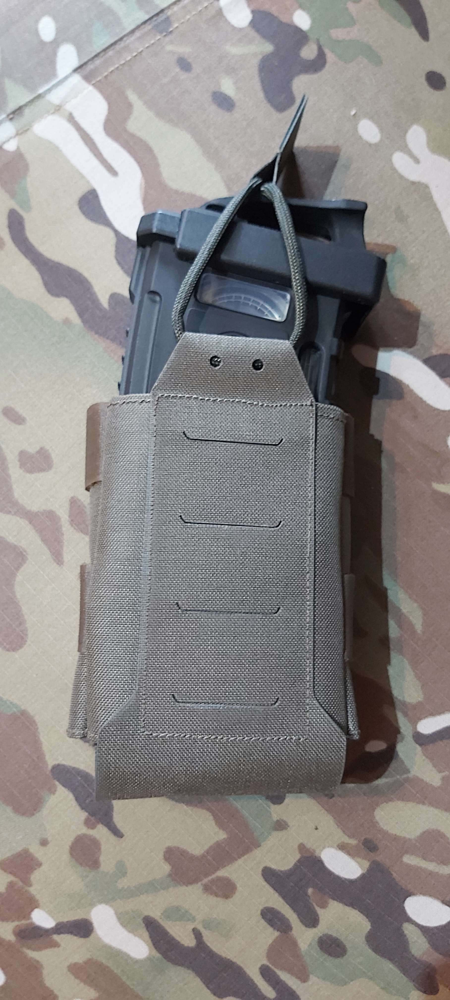
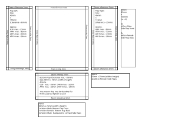
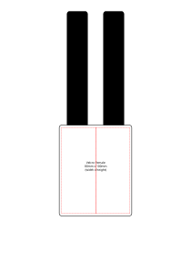

<!-- References -->
[iwtex]: https://www.iw-tex.de/
[tacticaltrim]: https://www.tacticaltrim.de/
[aktivstoffe]: https://www.aktivstoffe.de/
[extremtextil]: https://www.extremtextil.de/stoffe?p=26&limit=12

[iwtexmolle]: https://www.iw-tex.de/produkt/molle-pals-befestigung-mit-steg-5-x-2-steingrauoliv-gen-2/
[tacticaltrimmvelcrofemale100mm]: https://www.tacticaltrim.de/VELCRO-Flausch-RAL7013-100mm-Meterware
[iwtexcordura]: https://www.iw-tex.de/produkt/560-dtex-cordura-pu-beschichtet-irr-steingrauoliv-meterware/

<!-- References: Repository -->
[home]: ./../../../../README.md
[self]: ./README.md
[category_pouch]: ./../../../../Pouches/README.md
[category_magazine]: ./../../../../Pouches/Magazine/README.md
[backpanel]: ./../../../../Pouches/Backpanel/README.md
<!-- References: Calculator -->
[calculator]: ./Calculator.html

<!-- Navigation -->
<a id="id_navigation" style="color: #dddddd; text-decoration:none">Navigation</a> 
[Home][home] &bullet; [Pouch][category_pouch] &bullet; [Magazine][category_magazine] &bullet; [Single (Mid Cut)][self]

<!-- Directory -->

Directory

&nbsp;&nbsp;&nbsp;&nbsp;&bullet;
<a href="#id_description" style="color: #000000; text-decoration: none"> Description</a>
<a href="#id_description" style="color: #000000; text-decoration: none">&#x21B4;</a>
 
&nbsp;&nbsp;&nbsp;&nbsp;&bullet;
<a href="#id_resources" style="color: #000000; text-decoration: none"> Resources</a>
<a href="#id_resources" style="color: #000000; text-decoration: none">&#x21B4;</a>
 
&nbsp;&nbsp;&nbsp;&nbsp;&bullet;
<a href="#id_templates" style="color: #000000; text-decoration: none"> Templates</a>
<a href="#id_templates" style="color: #000000; text-decoration: none">&#x21B4;</a>
 
&nbsp;&nbsp;&nbsp;&nbsp;&bullet;
<a href="#id_variations" style="color: #000000; text-decoration: none"> Variations</a>
<a href="#id_variations" style="color: #000000; text-decoration: none">&#x21B4;</a>
 
&nbsp;&nbsp;&nbsp;&nbsp;&bullet;
<a href="#id_calculator" style="color: #000000; text-decoration: none"> Calculator</a>
<a href="#id_calculator" style="color: #000000; text-decoration: none">&#x21B4;</a>
 

<!-- Description -->
<h2>
Magazine Pouch Multifit (Mid Cut)</a>
<a href="#id_navigation" style="color: #000000; text-decoration: none">&#x21B0;</a>
</h2>
</img> 
(Pouch on Image was created with a Molle Module instead of the described bottom Flap)

<!-- Resources -->
<h3>
<a id="id_resources" style="color: #000000; text-decoration: none">Resources</a>
<a href="#id_navigation" style="color: #000000; text-decoration: none">&#x21B0;</a>
</h3>
Materials for this Project where sourced from this Shops 
<a href="https://www.iw-tex.de/">IW-Tex</a> (https://www.iw-tex.de/) 
<a href="https://www.tacticaltrim.de/">Tacticaltrim</a> (https://www.tacticaltrim.de/) 

---
| [Molle Panel 4x3][iwtexmolle] | [Velcro Female(100mm)][tacticaltrimmvelcrofemale100mm] | [Cordura Fabric][iwtexcordura] | Velcro Male(25mm) | Velcro Female(25mm)
| :- | :- | :- | :- | :-  
|  |  |  |  | 
| Used for the Backpanel | Used for the Backpanel and Frontpanel Lining | Used for the Frontpanel | Used on Back and Frontpanel to attach Frontpanel | Used on Frontpanel for attachment and size adjustment
---
*Sewing Thread is not listed

<!-- Templates -->
<h3>
<a id="id_templates" style="color: #000000; text-decoration: none">Cutting Templates</a>
<a href="#id_navigation" style="color: #000000; text-decoration: none;">&#x21B0;</a>
</h3>

Page 1 (Din-A4 Portrait)

</img>

<!-- Instructions -->
<h3>
<a id="id_calculator" style="color: #000000; text-decoration: none;">Instructions</a>
<a href="#id_navigation" style="color: #000000; text-decoration: none;">&#x21B0;</a>
</h3>

<strong>1.</strong> Preparation

<strong>1.1</strong> Backpanel 
- 1x Molle Panel 4x2 
- 1x Velcro Female 100mm x 80mm (height x width) 
<strong>1.2</strong> Frontpanel 
- 1x Fabric Center Piece 110mm x 90mm (height x width) 
- 1x Velcro Female Piece 100mm x 90mm (height x width) 
- 2x Fabric Flap Piece 110mm x 45mm (height x width) 
- 2x Velcro Strip Male 100m x 25mm (length x width) 
- 2x Velcro Strip Female 100mm x 25mm (length x width) 
- 4x Velcro Strip Female 65mm x 25mm (length x width) 
- 1x Fabric Flap Piece 45mm x 90mm (height x width) 
- 3x Velcro Strip Male 80mm x 25mm (length x height) 
- 1x Velcro Strip Female 80mm x 25mm (length x height) 

<strong>2.</strong> Backpanel

- 1x Molle Panel 4x2 
- 1x Velcro Female 100mm x 80mm (height x width) 
<strong>2.1</strong> Place the Female Velcro Patch on the Molle Panel and sew it in place with horizontal seams the top and bottom and vertical seams on the left, right and center. 
<strong>2.2</strong> Fold the Latches at the end of the Molle Loops on the Molle Panel outwards and sew them in place. 
</img>

<strong>3.</strong> Frontpanel

<strong>3.1</strong> Frontpanel - Assemble the Center Piece

- 1x Fabric Center Piece 110mm x 90mm (height x width) 
- 1x Velcro Female Piece 100mm x 90mm (height x width) 
<strong>3.1</strong> Roll up the upper Margin on the Fabric Piece and place the Velcro Patch on top and Seam it in place. 
Place another Seam at the Bottom of the Velcro Patch to fix it to the Fabric Piece. 
<!-- </img> -->

<strong>3.2</strong> Frontpanel - Assemble the Left Flap

- 1x Fabric Flap Piece 110mm x 45mm (height x width) 
- 1x Velcro Strip Male 100m x 25mm (length x width) 
- 1x Velcro Strip Female 100mm x 25mm (length x width) 
- 2x Velcro Strip Female 65mm x 25mm (length x width) 
<strong>3.2.1</strong> Roll up the upper and bottom Seam Margins on the Fabric Piece and seam them in place. 
<strong>3.2.2</strong> Place the 100mm long Male and Female Velcro Strips on top of each other with the Velcro facing outwards and place a seam on one side. 
<strong>3.2.3</strong> Place the combined 100mm Velcro Strip on the lefthand side of the Fabric Piece with 5mm overlap with the Male Velcro facing forward on the Fabric and the Female Velcro facing backward on the Fabric and seam it in place. Add Seams on the top and bottom of the combined 100mm Velcro Strip. 
<strong>3.2.4</strong> Place one of the 65mm long Female Velcro Strip at the top of the Fabric Flap and the other below with 25mm spacing between. 
Sew the two Velcro Strips on the short right hand side in place.

<strong>3.3</strong> Frontpanel - Assemble the Right Flap

- 1x Fabric Flap Piece 110mm x 45mm (height x width) 
- 1x Velcro Strip Male 100m x 25mm (length x width) 
- 1x Velcro Strip Female 100mm x 25mm (length x width) 
- 2x Velcro Strip Female 65mm x 25mm (length x width) 
<strong>3.3.1</strong> Roll up the upper and bottom Seam Margins on the Fabric Piece and seam them in place. 
<strong>3.3.2</strong> Place the 100mm long Male and Female Velcro Strips on top of each other with the Velcro facing outwards and place a seam on one side. 
<strong>3.3.3</strong> Place the combined 100mm Velcro Strip on the righthand side of the Fabric Piece with 5mm overlap with the Male Velcro facing forward on the Fabric and the Female Velcro facing backward on the Fabric and seam it in place. Add Seams on the top and bottom of the combined 100mm Velcro Strip. 
<strong>3.3.4</strong> Place one of the 65mm long Female Velcro Strip at the top of the Fabric Flap and the other below with 25mm spacing between. 
Sew the two Velcro Strips on the short left hand side in place.

<strong>3.4</strong> Frontpanel - Assemble the Bottom Flap

- 1x Fabric Flap Piece 45mm x 90mm (height x width) 
- 1x Velcro Strip Male 80mm x 25mm (length x height) 
- 1x Velcro Strip Female 80mm x 25mm (length x height) 
<strong>3.4.1</strong> Roll up the left and right Seam Margins on the Fabric Piece an seam them in place. 
<strong>3.4.2</strong> Place the 80mm long Male and Female Velcro Strips on top of each other with the Velcro facing outwards and place a seam on one side. 
<strong>3.4.3</strong> Place the combined 80mm Velcro Strip on the bottom of Fabric Piece with 5mm Overlap with the Male Velcro facing forward on the Fabric and the Female Veclro facing backward ont the Fabric and seam it in place. Add Seams on the left and right of the combined 80mm Velcro Strip.

<strong>3.5</strong> Frontpanel - Assemble the Frontpanel

<strong>3.5.1</strong> Place the <i>Bottom Flap</i> on top of the <i>Center Flap</i> with the Fabrics Outside facing inward and align the Seam Overlaps of the <i>Center Flap</i> and <i>Bottom Flap</i> on the bottom. Place a double Seam at the bottom Overlap. 
<strong>3.5.2</strong> Place the <i>Left Side Flap</i> on top of the <i>Center Flap</i> with the Fabrics outside facing inward and align the Fabric Pieces 5mm Seam Overlap on the left side. Place a double Seam at the Seam Overlap. 
<strong>3.5.3</strong> Place the <i>Right Side Flap</i> on top of the <i>Center Flap</i> with the Fabrics Outside facing inward and align the Seam Overlaps of the <i>Center Flap</i> and <i>Right Side Flap</i> on the righthand side. Place a double Seam at the Seam Overlap. 

<strong>4.</strong> Pouch - Assemble the Pouch

<strong>4.1</strong> Take the <i>Front Flap</i> and wrap the <i>Side Flaps</i> and <i>Bottom Flap</i> around your Magazine. 
<strong>4.2</strong> Place the Frontflap on the Backpanels Velcro. 
<strong>4.3</strong> Wrap the Velcro Strips on the Frontpanels Sideflaps around the Pouch to the Backside of the Backpanel. Fix them in place using the remaining 80mm Male Velcro Strips. 

<!-- Variations -->
<h3>
<a id="id_variations" style="color: #000000; text-decoration: none;">Possible Variations</a>
<a href="#id_navigation" style="color: #000000; text-decoration: none;">&#x21B0;</a>
</h3>
- The Frontpanel can host Molle-Lasercuts to attach other Equipment 
- The Frontpanel can host Velcro or Buckles to close a inserted Latch 
- For the Front Panels Sides and Bottom Flaps elastic fabric could be used to achieve more retention. 
- Separator to use for SMG-Magazines

<!-- Calculator -->
<h3>
<a id="id_calculator" style="color: #000000; text-decoration: none;">Material Cost Calculator</a>
<a href="#id_navigation" style="color: #000000; text-decoration: none;">&#x21B0;</a>
</h3>
Download the <a href="calculator.html">Calculator html</a> and open it with your browser to calculate the Cost of Materials used for this Piece of Gear. 